<div align="center">

<a href="https://lipen.github.io/nexus-raw/how-to/demo/">

</a>

# nexus-raw

**curl for a Sonatype Nexus raw repository: HTTP primitives, parallel directory transfers, sha256 markers and resume.**

[](https://github.com/Lipen/nexus-raw/actions/workflows/ci.yml)
[](https://crates.io/crates/nexus-raw)
[](https://www.npmjs.com/package/@nexus-raw/nxr)

[Docs](https://lipen.github.io/nexus-raw/) · [Install](#install) · [Use](#use) · [Commands](#commands) · [CI](#ci) · [README на русском](README.ru.md)

</div>

## What it does

One command moves a whole directory to the server, or takes it back.
Every artifact travels with a `<name>.sha256` marker, checked on the way.
A second run moves only what is missing, and an interrupted one resumes where it stopped.
A build that differs from the release already on the server is refused, never overwritten.

## Install

```bash
# Homebrew, macOS and Linux
brew tap lipen/nexus-raw https://github.com/Lipen/nexus-raw
brew install lipen/nexus-raw/nexus-raw

# a prebuilt static archive, without a compile step
cargo binstall nexus-raw

# the npm package, which also puts `nxr` on PATH
npm install -g @nexus-raw/nxr

# the container image
docker run --rm ghcr.io/lipen/nexus-raw:latest --version
```

`cargo install nexus-raw` builds from source and needs Rust 1.88 or newer.
The per-platform archives and a `SHA256SUMS` file sit in [GitHub Releases](https://github.com/Lipen/nexus-raw/releases/latest), and the [container variants](docs/how-to/containers.md) have their own page.

## Use

```bash
nxr up dist/1.4.0/ https://nexus.example.com/repository/raw-main/1.4.0/
```

```console
$ nxr up dist/1.4.0/ https://nexus.example.com/repository/raw-main/1.4.0/
plan: 4 to upload, 0 to download, 0 up to date
↑ manifest.json ok
↑ pinned.xml ok
↑ bom/linux-x86_64.json ok
↑ app-1.4.0.zip ok
uploaded 4, downloaded 0, skipped 0
```

A terminal shows this run as one live line.
The per-name lines above are what a pipe or a log captures.

The session at the top shows the guarantee: a release directory lands, a rebuild with different bytes aims at the same version, and the publish refuses instead of overwriting.
[Get started](docs/get-started.md) runs the same thing against a local mock server, including an interrupted transfer.

## Commands

| Command | What it does |
|:--------|:-------------|
| `nxr up <DIR> <URL>` | upload a directory and its markers in parallel |
| `nxr down <URL> <DIR>` | download the listed names, verified and resumable |
| `nxr verify <DIR>` | check local bytes, markers and digests offline |
| `nxr diff <DIR> <URL>` | report the difference, exit 1 when there is one |
| `nxr ls <URL>` | list a directory at any depth |
| `nxr channel get\|set` | read or write a channel token |

`down`, `diff` and `rm` take their names from `--name`, `--names-from FILE`, `--ls`, or a URL that ends at a file.
The rest is `get`, `put`, `head` and `sha` for one URL at a time, plus `clone`, `mirror`, `mv`, `rm`, `point`, `audit`, `doctor`, `service` and `complete`.
The [CLI reference](docs/reference/cli.md) has every flag, output format and edge case.

## CI

A GitHub Actions workflow can run the composite action from this repository:

```yaml
- uses: Lipen/nexus-raw@v0.25.0
  with:
    command: up
    args: ./dist/1.4.0/ https://nexus.example.com/repository/raw-main/1.4.0/
    auth: ${{ secrets.NEXUS }}     # user:password, exported through the environment
```

Exit codes separate failure classes: `0` success, `1` data, `2` misuse, `3` transport.
A `3` deserves a retry.
A `1` will reproduce.
`--json` prints one NDJSON event per line and ends with a `summary` event to gate on.
GitLab CI, a `jq` gate and masked variables are in [use in CI](docs/how-to/ci.md).
The codes with causes and fixes are in [errors and exit codes](docs/reference/errors.md).

## Credentials

The sources are checked in this order, and the first one found is used:

1. `-u user:pass` on the call, which is visible in `ps` and suits manual use only.
2. `NXR_AUTH`, the base64 of `user:pass`.
3. `NXR_USERNAME` and `NXR_PASSWORD`, which are set together.

```bash
export NXR_USERNAME="my-login"
export NXR_PASSWORD="my-password"
```

`nxr doctor [URL]` reports which source was used and does not print the value.
Long URLs can be named in an alias file that is read only when `-R` names one: [name your remotes](docs/how-to/config.md).

## Other clients

| Component | Description | Install |
|:---|:---|:---|
| **Terminal browser** `nxr-tui` | tabs per server, repository tree at any depth, subtree downloads, live filter, saved presets | `cargo install nexus-raw-tui` |
| **Mount** `nxr-mount` | a raw repository as a local read-only directory, with lazy ranged reads over FUSE, Linux only | included in the release archives |
| **Rust library** `nexus-raw-core` | the `Nxr` facade with the same transfers, events and rejections, in process | `cargo add nexus-raw-core` |
| **Node package** `@nexus-raw/nxr` | the CLI operations as promises for a Node program | `npm install @nexus-raw/nxr` |

[TUI reference](docs/reference/tui.md) · [the mount](docs/reference/mount.md) · [Rust API](docs/reference/api.md) · [Node quickstart](docs/tutorials/node.md)

## Documentation

- The site: <https://lipen.github.io/nexus-raw/>, sources in [docs/](docs/), served locally by `just docs`.
- [Wire protocol](docs/reference/protocol.md) and [invariants](docs/reference/invariants.md) are written for people implementing another client.
- [Design](docs/explanation/design.md) records the decisions, and [conformance](docs/explanation/conformance.md) records the test evidence behind the guarantees above.
- How-tos: [publish](docs/how-to/publish.md), [consume](docs/how-to/consume.md), [audit](docs/how-to/audit.md), [integrate](docs/how-to/integrate.md).
- Agents: [docs/how-to/agents.md](docs/how-to/agents.md), the [`skills/nxr/`](skills/nxr) skill, and [llms.txt](https://lipen.github.io/nexus-raw/llms.txt).
- Changes per release: [CHANGELOG.md](CHANGELOG.md).

## Contributing

[CONTRIBUTING.md](CONTRIBUTING.md) covers the build, the tests, the commit rules and the release checklist.
[AGENTS.md](AGENTS.md) describes the repository layout, and `just check` runs the full gate.

## License

[MIT](./LICENSE)
