<div align="center">

<a href="https://lipen.github.io/nexus-raw/how-to/demo/">

</a>

# nexus-raw

`nxr` is curl for a Sonatype Nexus raw repository.

The same engine ships as three surfaces: the `nxr` CLI, the `nexus-raw-core` Rust crate (the `Nxr` facade), and the `nexus-raw` npm package for Node, which exposes the same facade as promises over a napi addon.

[](https://github.com/Lipen/nexus-raw/actions/workflows/ci.yml)
[](https://github.com/Lipen/nexus-raw/actions/workflows/docs.yml)
[](https://crates.io/crates/nexus-raw)
[](https://www.npmjs.com/package/@nexus-raw/nxr)

[Docs](https://lipen.github.io/nexus-raw/) · [Install](#install) · [Quick start](#quick-start) · [Commands](#commands) · [README на русском](README.ru.md)

</div>

## Install

Prebuilt binaries ride on [GitHub Releases](https://github.com/Lipen/nexus-raw/releases/latest), with checksums in [`SHA256SUMS`](https://github.com/Lipen/nexus-raw/releases/latest/download/SHA256SUMS):

| File | Platform |
|:-----|:---------|
| [`nxr-linux-x64.tar.gz`](https://github.com/Lipen/nexus-raw/releases/latest/download/nxr-linux-x64.tar.gz) | Linux x86_64, statically linked |
| [`nxr-linux-aarch64.tar.gz`](https://github.com/Lipen/nexus-raw/releases/latest/download/nxr-linux-aarch64.tar.gz) | Linux arm64, statically linked |
| [`nxr-darwin-x64.tar.gz`](https://github.com/Lipen/nexus-raw/releases/latest/download/nxr-darwin-x64.tar.gz) | macOS Intel |
| [`nxr-darwin-arm64.tar.gz`](https://github.com/Lipen/nexus-raw/releases/latest/download/nxr-darwin-arm64.tar.gz) | macOS Apple silicon |
| [`nxr-windows-x64.tar.gz`](https://github.com/Lipen/nexus-raw/releases/latest/download/nxr-windows-x64.tar.gz) | Windows x86_64 |

`cargo binstall` fetches the same archives:

```bash
cargo binstall nexus-raw
```

A GitHub Actions workflow installs and runs `nxr` through the composite action shipped in this repository:

```yaml
- uses: Lipen/nexus-raw@v0.18.0
  with:
    command: up
    args: ./dist/1.4.0/ https://nexus.example.com/repository/raw-main/1.4.0/
```

From npm, with the native addon fetched as a prebuilt package:

```bash
npm install @nexus-raw/nxr
```

From crates.io:

```bash
cargo install nexus-raw
```

From the repository:

```bash
cargo install --git https://github.com/Lipen/nexus-raw nexus-raw --locked
```

From a checkout:

```bash
cargo install --path crates/nexus-raw --locked
```

The cargo paths build from source, so they need Rust 1.88 or newer.
Check the install with `nxr --version`.

## Quick start

From a directory of files to a verified local copy:

```bash
BASE=https://nexus.example.com/repository/raw-main

nxr up dist/1.4.0/ "$BASE/1.4.0/"
nxr channel set "$BASE/latest" 1.4.0 --if-forward
V=$(nxr channel get "$BASE/latest")
printf 'app-1.4.0.zip\n' > names.txt
nxr down "$BASE/$V/" vendor/prebuilt --names-from names.txt
nxr verify vendor/prebuilt
```

If a transfer is interrupted, run the same command again: what already landed is skipped, the rest continues.

## Commands

| Command | Does |
|:--------|:-----|
| `nxr get <URL> [-o FILE] [--continue] [--segments N]` | GET to a file (via `.part`, resume through Range, or `N` concurrent spans) or stdout |
| `nxr put <URL> -f FILE [--sha]` | PUT bytes: `--sha` also PUTs the `.sha256` sibling |
| `nxr head <URL>` | status, size, content type |
| `nxr sha <FILE\|URL>` | streaming sha256 of a file or a remote object |
| `nxr up <SRC_DIR> <DST_URL> [--no-sha] [--if-changed] [--plan] [--claim-first NAME]` | scan → diff → PUT bytes + markers in parallel workers |
| `nxr down <SRC_URL> <DST_DIR> [--name N]... [--names-from F]... [--ls] [--fresh] [--plan] [--prefix P]` | enumerate → diff → stream+hash → rename + local marker |
| `nxr diff <LOCAL_DIR> <SRC_URL> [--name N]... [--names-from F]... [--ls] [--prefix P] [--via search [--fallback]]` | compare a local directory against the storage: `same` / `missing-local` / `missing-remote` / `diverged` (size, sha). Exit 1 when different, nothing written. `--via search` reads the remote facts from the search listing |
| `nxr mirror <SRC_URL> <DST_URL> [--name N]... [--names-from F]... [--ls] [--dry-run] [--src-user U] [--dst-user U] [--prefix P]` | enumerate at the source, diff at the destination, copy bytes + markers |
| `nxr rm <SRC_URL> [--name N]... [--names-from F]... [--ls] [--prefix P] [--yes]` | enumerate → plan by default, `--yes` DELETEs each marker, then its bytes (404 is fine, read-only refuses) |
| `nxr mv <SRC_URL> <DST_URL> [--name N]... [--names-from F]... [--ls] [--prefix P] [--yes] [--src-user U] [--dst-user U]` | mirror into the destination, then delete at the source: plan by default, `--yes` moves (nothing deleted until the pour converged) |
| `nxr point <URL>` | DELETE a pointer file (channel ref, absent is fine) |
| `nxr ls <URL> [--assets]` | the raw-tree listing of a directory URL, any depth (folders `/`-marked). `--assets`: flat artifact names |
| `nxr channel get <URL>` | print the current token (`unset` when empty) |
| `nxr channel set <URL> <TOKEN> [--if-forward]` | write a token (`--if-forward` accepts only forward moves in dotted-numeric order) |
| `nxr verify <DIR>` | local bytes + marker + digest only, no network |
| `nxr doctor [URL]` | credentials, TLS, settings, reachability |
| `nxr service repos <URL>` | list the repositories of a server (the service REST API, any URL of that server works) |
| `nxr service status <URL>` | server liveness and writability behind the URL |
| `nxr service repo <URL> [--detail]` | what the repository behind the URL is. `--detail` adds the full settings (nx-admin only) |
| `nxr service assets <URL> [--q Q] [--prefix P]` | every asset of the repository through the search API, any format |
| `nxr service eula <URL> [--accept]` | the server's EULA gate. `--accept` opens it (nx-admin) |
| `nxr complete <shell>` | print a shell completion script to stdout (bash, zsh, fish, powershell) |

`down`, `diff`, `mirror`, `mv` and `rm` enumerate explicitly: repeatable `--name`, `--names-from FILE` (one name per line, `-` is stdin), or best-effort `--ls` when the server has the search API.
With neither they refuse.

Exit codes: 0 ok, 1 data problem, 2 misuse, 3 transport.
Every error prints a `hint:` line.
`--json` emits one JSON object per line on stdout.

## Terminal browser

`nxr-tui` browses a raw repository in the terminal: one tab per server, the repository tree at any depth, subtree downloads, a live filter and server presets.

```bash
cargo install nexus-raw-tui
nxr-tui https://nexus.example.com/     # or with no arguments: the config presets
```

Keys, the config file and the headless smoke mode: [the TUI reference](docs/reference/tui.md).

## Credentials

- Sources, in checked order: `-u user:pass`, then `NXR_AUTH` (base64 of `user:pass`), then `NXR_USERNAME` + `NXR_PASSWORD`.
- `-R <alias>` names a remote from `~/.config/nxr/config.toml` (one TOML of named URLs + credential sources): the file is read only when the flag names an alias. See [how-to/config.md](docs/how-to/config.md).
- `NXR_CONFIG=/path/to/file` moves the alias file off its default location.

```bash
export NXR_USERNAME="my-login"
export NXR_PASSWORD="my-password"

# or one value for CI: base64 of "my-login:my-password"
export NXR_AUTH="$(printf '%s:%s' 'my-login' 'my-password' | base64)"
```

`nxr doctor [URL]` names the source that resolved, without printing values.

## For agents

The one-page cookbook: intent -> command -> expected result, in [docs/how-to/agents.md](docs/how-to/agents.md).
The machine-readable doc index is [llms.txt](https://lipen.github.io/nexus-raw/llms.txt).

## Docs

Guides and reference: <https://lipen.github.io/nexus-raw/>.
Notable changes per release: [CHANGELOG.md](CHANGELOG.md).
Sources live in [docs/](docs/).
`just docs` serves the site locally.

## Contributing

Build, test, commit, protocol changes and the release checklist: [CONTRIBUTING.md](CONTRIBUTING.md).
Repository layout and the rules for changing things: [AGENTS.md](AGENTS.md).
`just check` runs the full gate.
`just demo` runs the recorded session against the local mock server.

## License

MIT, see [LICENSE](LICENSE).
