<div align="center">

<a href="https://lipen.github.io/nexus-raw/how-to/demo/">

</a>

# nexus-raw

**curl для raw-репозитория Sonatype Nexus: HTTP-примитивы, параллельные передачи каталогов, маркеры sha256 и докачка.**

[](https://github.com/Lipen/nexus-raw/actions/workflows/ci.yml)
[](https://crates.io/crates/nexus-raw)
[](https://www.npmjs.com/package/@nexus-raw/nxr)

[Документация](https://lipen.github.io/nexus-raw/) · [Установка](#установка) · [Использование](#использование) · [Команды](#команды) · [CI](#ci) · [README in English](README.md)

</div>

## Что делает

Одна команда переносит целый каталог на сервер или забирает его обратно.
Каждый артефакт едет вместе с маркером `<name>.sha256`, который проверяется по дороге.
Второй запуск переносит только недостающее, а прерванный продолжается с места остановки.
Сборка, отличающаяся от уже лежащего на сервере релиза, получает отказ и не перезаписывается.

## Установка

```bash
# Homebrew, macOS и Linux
brew tap lipen/nexus-raw https://github.com/Lipen/nexus-raw
brew install lipen/nexus-raw/nexus-raw

# готовый статический архив, без шага сборки
cargo binstall nexus-raw

# npm-пакет, который заодно кладёт `nxr` в PATH
npm install -g @nexus-raw/nxr

# образ контейнера
docker run --rm ghcr.io/lipen/nexus-raw:latest --version
```

`cargo install nexus-raw` собирает из исходников и требует Rust 1.88 или новее.
Архивы под платформы и файл `SHA256SUMS` лежат в [GitHub Releases](https://github.com/Lipen/nexus-raw/releases/latest), а у [вариантов контейнера](docs/how-to/containers.md) есть своя страница.

## Использование

```bash
nxr up dist/1.4.0/ https://nexus.example.com/repository/raw-main/1.4.0/
```

```console
$ nxr up dist/1.4.0/ https://nexus.example.com/repository/raw-main/1.4.0/
plan: 4 to upload, 0 to download, 0 up to date
↑ manifest.json ok
↑ pinned.xml ok
↑ bom/linux-x86_64.json ok
↑ app-1.4.0.zip ok
uploaded 4, downloaded 0, skipped 0
```

В терминале этот запуск рисуется одной живой строкой.
Строки по именам выше это то, что захватывает pipe или лог.

Сессия в начале страницы показывает гарантию: каталог релиза уходит на сервер, пересборка с другими байтами метит в ту же версию, и публикация отказывается перезаписывать уже вышедший релиз.
Страница [get-started](docs/get-started.md) делает то же против локального мок-сервера, включая прерванную передачу.

## Команды

| Команда | Что делает |
|:--------|:-----------|
| `nxr up <DIR> <URL>` | загрузить каталог и его маркеры параллельно |
| `nxr down <URL> <DIR>` | скачать перечисленные имена, с проверкой и докачкой |
| `nxr verify <DIR>` | проверить локальные байты, маркеры и дайджесты офлайн |
| `nxr diff <DIR> <URL>` | отчёт о различиях, код 1 когда они есть |
| `nxr ls <URL>` | листинг каталога на любой глубине |
| `nxr channel get\|set` | прочитать или записать токен канала |

`down`, `diff` и `rm` берут имена из `--name`, `--names-from FILE`, `--ls` или из URL, оканчивающегося файлом.
Остальное это `get`, `put`, `head` и `sha` для одного URL за раз, плюс `clone`, `mirror`, `mv`, `rm`, `point`, `audit`, `doctor`, `service` и `complete`.
В [справочнике CLI](docs/reference/cli.md) есть каждый флаг, формат вывода и краевой случай.

## CI

Workflow GitHub Actions может запустить composite action из этого репозитория:

```yaml
- uses: Lipen/nexus-raw@vX.Y.Z
  with:
    command: up
    args: ./dist/1.4.0/ https://nexus.example.com/repository/raw-main/1.4.0/
    auth: ${{ secrets.NEXUS }}     # user:password, экспортируется через окружение
```

`vX.Y.Z` это тег релиза: актуальный номер стоит в [английском README](README.md#ci).

Коды возврата разделяют классы ошибок: `0` успех, `1` данные, `2` некорректный вызов, `3` транспорт.
Код `3` заслуживает повтора.
Код `1` воспроизведётся.
`--json` печатает по одному событию NDJSON на строку и завершается событием `summary`, по которому job может выставить условие.
GitLab CI, гейт `jq` и masked-переменные описаны в [использовании в CI](docs/how-to/ci.md).
Коды с причинами и исправлениями собраны в [ошибках и кодах возврата](docs/reference/errors.md).

## Учётные данные

Источники проверяются в этом порядке, используется первый найденный:

1. `-u user:pass` в вызове, значение видно в `ps`, поэтому способ подходит только для ручного запуска.
2. `NXR_AUTH`, base64 от `user:pass`.
3. `NXR_USERNAME` и `NXR_PASSWORD`, которые задаются вместе.

```bash
export NXR_USERNAME="my-login"
export NXR_PASSWORD="my-password"
```

`nxr doctor [URL]` сообщает, какой источник сработал, и не печатает значение.
Длинные URL можно назвать в файле алиасов, который читается только когда `-R` называет алиас: [именованные ремоуты](docs/how-to/config.md).

## Другие клиенты

| Компонент | Описание | Установка |
|:---|:---|:---|
| **Терминальный браузер** `nxr-tui` | вкладки на сервер, дерево репозитория на любой глубине, скачивание поддеревьев, живой фильтр, сохранённые пресеты | `cargo install nexus-raw-tui` |
| **Монтирование** `nxr-mount` | raw-репозиторий как локальный каталог только для чтения, ленивые Range-чтения через FUSE, только Linux | входит в архивы релиза |
| **Rust-библиотека** `nexus-raw-core` | фасад `Nxr` с теми же передачами, событиями и отказами в процессе | `cargo add nexus-raw-core` |
| **npm-пакет** `@nexus-raw/nxr` | операции CLI в виде промисов для программы на Node | `npm install @nexus-raw/nxr` |

[Справочник TUI](docs/reference/tui.md) · [монтирование](docs/reference/mount.md) · [Rust API](docs/reference/api.md) · [быстрый старт на Node](docs/tutorials/node.md)

## Документация

- Сайт: <https://lipen.github.io/nexus-raw/>, исходники в [docs/](docs/), локально поднимается через `just docs`.
- [Протокол](docs/reference/protocol.md) и [инварианты](docs/reference/invariants.md) написаны для тех, кто реализует собственный клиент.
- [Design](docs/explanation/design.md) фиксирует принятые решения, а [conformance](docs/explanation/conformance.md) описывает тестовые доказательства гарантий выше.
- How-to: [публикация](docs/how-to/publish.md), [потребление](docs/how-to/consume.md), [аудит](docs/how-to/audit.md), [интеграция](docs/how-to/integrate.md).
- Агентам: [docs/how-to/agents.md](docs/how-to/agents.md), скилл [`skills/nxr/`](skills/nxr) и [llms.txt](https://lipen.github.io/nexus-raw/llms.txt).
- Что изменилось между релизами: [CHANGELOG.md](CHANGELOG.md).

## Участие

[CONTRIBUTING.md](CONTRIBUTING.md) описывает сборку, тесты, правила коммитов и чеклист релиза.
[AGENTS.md](AGENTS.md) описывает устройство репозитория, а `just check` запускает полный цикл проверок.

## Лицензия

[MIT](./LICENSE)
