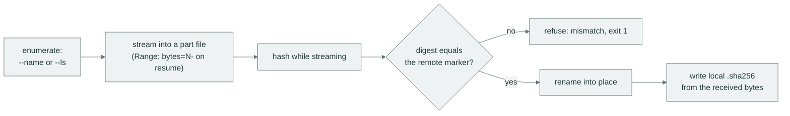

# Consume artifacts

The consumer side: resolve which version is current, fetch it (or a slice of it) into a directory you can build against, and prove it intact without the network.
The scenario behind every transcript here: your build needs the artifacts of version `1.4.0` from the `raw-main` repository into `vendor/app/`.

## Prerequisites

- Reachable repository URL, for example `https://nexus.example.com/repository/raw-main/`.
- Credentials that may read it (`export NXR_USERNAME=… NXR_PASSWORD=…`).
- A target directory, created on demand.

## Choosing an enumeration source

`down` must know which names to fetch, and a Nexus raw repository has no guaranteed directory listing.
`down` names its source on every call, and there is no silent default:

| Source | Invocation | Reach for it when |
|:-------|:-----------|:------------------|
| explicit names, repeatable | `nxr down <ver-url>/ vendor/app/ --name app.zip` | a job needs one or two files, or a pipeline owns its list |
| server search API | `nxr down <ver-url>/ vendor/app/ --ls` | best effort: needs a server with the search API and a repository-style URL |

Without a source, `down` refuses instead of guessing:

```console
$ nxr down https://nexus.example.com/repository/raw-main/1.3.0/ vendor/old/
error: cannot enumerate: https://nexus.example.com/repository/raw-main/1.3.0/: no --name/--names-from/--ls given
hint: repeat --name, use --names-from FILE, or use --ls when the server has the search API
```

Every name a source lists must exist, locally or remotely.
A typo stops the run with `missing` instead of silently fetching less.

## Resolve the version through a channel

Publishers tag the current version with a channel token.
Resolve it, then download the directory it names:

```bash
V=$(nxr channel get https://nexus.example.com/repository/raw-main/latest)   # (1)!
printf 'app-1.4.0.zip\npinned.xml\nbom/linux-x86_64.json\n' > names.txt     # (2)!
nxr down "https://nexus.example.com/repository/raw-main/$V/" vendor/app/ --names-from names.txt   # (3)!
```

1. Prints the bare token, so `$(…)` captures exactly the version.
2. The list is yours: a file in your pipeline, one name per line.
3. Everything under this URL that you named arrives, nothing else.

```console
$ nxr down https://nexus.example.com/repository/raw-main/1.4.0/ vendor/app/ --names-from names.txt
plan: 0 to upload, 3 to download, 0 up to date
↓ app-1.4.0.zip ok
↓ pinned.xml ok
↓ bom/linux-x86_64.json ok
uploaded 0, downloaded 3, skipped 0
```

Three names in the list, three fetched.

### What the pipeline guarantees

For every name, the same five steps run, in parallel across `--workers`:



Two consequences:

- A name that dies mid-download leaves only a hidden part file (`.nxr-part-<hash>`): the destination never holds partial bytes under a real name.
- The local marker is computed from the received bytes, so the result verifies offline even if the server had no marker.

## Re-runs diff instead of re-downloading

Delete a file (or lose it to a crashed build) and run the same command again:

```console
$ nxr down https://nexus.example.com/repository/raw-main/1.4.0/ vendor/app/
plan: 0 to upload, 1 to download, 2 up to date
○ app-1.4.0.zip skipped
○ bom/linux-x86_64.json skipped
↓ pinned.xml ok
uploaded 0, downloaded 1, skipped 2
```

Only the missing name transfers.
Names whose digest matches the server are skipped.
A locally complete artifact whose digest diverges refuses the run instead of being overwritten (see [divergent objects are never overwritten](troubleshoot.md#divergent-objects-are-never-overwritten)).

An interrupted pull recovers the same way: rerunning the command resumes the part files through `Range` requests by default, and `--fresh` starts over from zero.
The full walkthrough with a real interruption: [break it on purpose](../get-started.md#break-it-on-purpose).

## Fetch a subset

Name what you need and repeat `--name` as often as needed:

```console
$ nxr down https://nexus.example.com/repository/raw-main/1.4.0/ vendor/subset/ --name app-1.4.0.zip
plan: 0 to upload, 1 to download, 0 up to date
↓ app-1.4.0.zip ok
uploaded 0, downloaded 1, skipped 0
```

Keep the name list in your own pipeline: a shell array, a generated script, whatever the job owns.
Every listed name must exist on the server.
A ghost name refuses the run.

## Heavy artifacts: `get --segments`

A multi-gigabyte archive through one connection is one slow pipe, and a single stalled socket restarts the wait.
`get --segments N` splits the object into `N` contiguous byte-range spans and fetches them concurrently, then assembles, digest-checks and renames exactly like the plain download:

```console
$ nxr get https://nexus.example.com/repository/raw-main/1.4.0/app-1.4.0.zip -o app.zip --segments 4
↓ app-1.4.0.zip ok (4 segments)
```

The rules it plays by:

- the object needs a `Content-Length` (a HEAD answers it) and a server that honors `Range`: both are true for stock Nexus.
- a server or proxy that silently strips `Range` (the answer is `200`, not `206`) degrades the download to the single-stream path automatically, logged through the events: the artifact still lands, verified.
- an object smaller than the segment count just gets smaller segments, down to one byte each, still exact.
- `--segments` is a file-target flag: piped stdout stays a single stream, and `--continue` does not combine with it.

Pick `N` roughly by the pipe, not by the size: `4` wakes up a single-threaded remote, `8-16` fills a fat pipe.

## Verify without the network

Before building against the result, or after any manual fiddling, check every artifact against its marker, entirely offline:

```console
$ nxr verify vendor/app/
verify: 3 ok, FAILED: none
uploaded 0, downloaded 0, skipped 3
```

A tampered file is named and the run exits 1:

```console
$ nxr verify vendor/app/
uploaded 0, downloaded 0, skipped 2
failed: bom/linux-x86_64.json
error: incomplete: bom/linux-x86_64.json
hint: rerun the same command: finished names are skipped and the rest is retried
```

Two repairs fit: delete the offending file and let the next `down` refill it, or rebuild the artifact and regenerate its marker with `sha256sum`, whichever matches why the digest drifted.

As the last gate of a consumer CI job, `verify` costs no network (see [a consumer job](ci.md#a-consumer-job)).

## Next steps

- Publish the versions you consume: [publish a version](publish.md).
- The failure catalogue behind every refusal above: [when it breaks](troubleshoot.md).
- Flags, credentials and URL rules in full: [CLI reference](../reference/cli.md).
- What the part files and markers look like on the wire: [the wire protocol](../reference/protocol.md).
