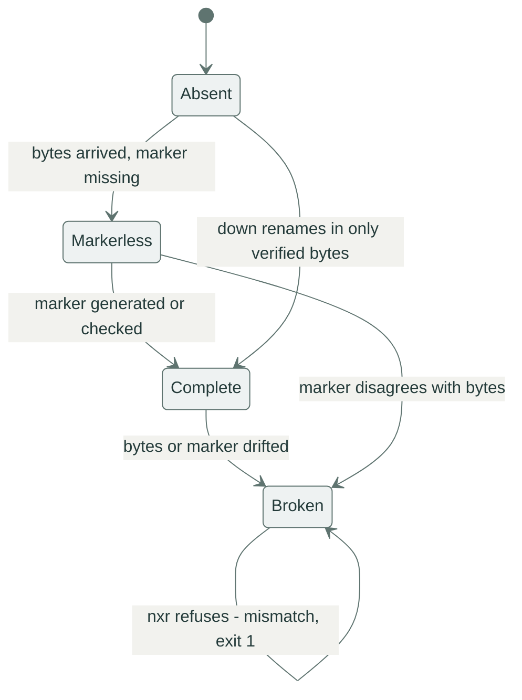

# When it breaks

Every failure has a name, an exit code and a hint.
Find yours in the tables, fix the cause, repeat the command: `up` skips finished names and `down` resumes from part files by default.

## Anatomy of a failure

```console
$ nxr up dist/1.4.0/ https://nexus.example.com/repository/raw-main/1.4.0/
error: mismatch: app-1.4.0.zip: complete on both sides with different digests: local 38e98b1651bd21fdc5da48c407b711947a0115b28a2b979cf637a5497c3720b5, remote 405e28e8bcf3d4a6a1098029dacc54c7ba14d9b08ecf2b3e15c377c0b896636a
hint: the two sides diverge: delete or fix one copy, never let nxr overwrite a diverging object
```

The `error:` line starts with the error kind and names the artifact and both sides of the disagreement.
The `hint:` line names the next check.
The same text travels in the `hint` field of `--json` output.
The process exit code separates data problems from transport trouble.

## Exit codes: cause and fix

| Exit | Kind | Cause | Fix |
|:-----|:-----|:------|:----|
| `0` | ok | transferred, converged or verified | carry on |
| `1` | `mismatch` | two sides disagree about a name's content | nobody overwrites: rebuild, or republish under a new version directory |
| `1` | `incomplete` | local copies unfinished at `verify` | rebuild (the list names the offenders) |
| `1` | `missing` | a requested name exists nowhere | check spelling, the `--name` list and the version directory |
| `1` | `cannot enumerate` | `down` has no name list | pass `--name` or `--ls` |
| `2` | `unsafe name` | a name fails the grammar | rename the artifact |
| `2` | `misuse` | bad flags, missing directory, half-set credentials | fix the invocation |
| `3` | `auth` | 401/403 or missing credentials | check `NXR_AUTH` / `NXR_USERNAME` + `NXR_PASSWORD`, or pass `-u` |
| `3` | `transport` | network, TLS or stall, with retries exhausted | repeat the command later, resume is free |
| `3` | `http <status>` | an unexpected response | read the status: 404 is a wrong path, 429 is a rate limit |

Full taxonomy with every field: [errors and exit codes](../reference/errors.md).

## The four states of an object

Every name, local or on the server, is in exactly one of four states.
`up` and `down` diff the two sides state by state, and the refusals fall out of the diff:



`Complete` means bytes plus a sibling whose digest matches.
`Markerless` means bytes only: normal mid-transfer, suspicious when a run finished.
`Broken` means bytes and marker disagree, and `nxr` will not fix it by overwriting: the next `up` or `down` refuses with `mismatch` until a human deletes or repairs one side.
`Absent` means no bytes, and a marker without bytes reads as `Absent`.

## Divergent objects are never overwritten

The refusal you will meet most often, with its two faces.

A local file drifted after its marker was written:

```console
$ nxr up dist/1.4.0/ https://nexus.example.com/repository/raw-main/1.4.0/
error: mismatch: pinned.xml: local object is broken and must not be overwritten: digest mismatch: sibling 8eed95dc200589a2b132c182fac5ce9335866b9d2aa0225760ef944bac4b09c5, actual 4925cd5b6a8a02b33a3bd303661d19a84a640c533b32b78229659be743c1d2f6
hint: the two sides diverge: delete or fix one copy, never let nxr overwrite a diverging object
```

The same name holds two different artifacts on the two sides, for example a rebuild published into a version directory that was already used:

```console
$ nxr up dist/1.4.0/ https://nexus.example.com/repository/raw-main/1.4.0/
error: mismatch: app-1.4.0.zip: complete on both sides with different digests: local 38e98b1651bd21fdc5da48c407b711947a0115b28a2b979cf637a5497c3720b5, remote 405e28e8bcf3d4a6a1098029dacc54c7ba14d9b08ecf2b3e15c377c0b896636a
hint: the two sides diverge: delete or fix one copy, never let nxr overwrite a diverging object
```

Exit 1 in both cases, and nothing was sent.
The way out is a decision, not a flag: rebuild and fix the local copy, or publish the new content under a new version directory and move the channel.

## Interrupted transfers

Kill a `get` mid-flight (`timeout` here stands in for `Ctrl-C`) and the bytes so far live in a part file next to the target:

```console
$ timeout 4 nxr get https://nexus.example.com/repository/raw-main/1.4.0/app-1.4.0.zip -o app.zip
$ echo $?
124
$ ls -A | grep app.zip
app.zip.part
```

Nothing partial ever hides under the real name.
Repeat the command with `--continue` and the transfer resumes through a `Range: bytes=N-` request instead of starting over:

```console
$ nxr get https://nexus.example.com/repository/raw-main/1.4.0/app-1.4.0.zip -o app.zip --continue
get: 98304 bytes → app.zip (resumed from 32768)
```

The `(resumed from …)` figure is the part-file size the server was asked to continue from.
For a whole directory the same story runs through `down`: rerunning the command resumes its part files by default (see [break it on purpose](../get-started.md#break-it-on-purpose) for the part-file anatomy).

A killed `up` leaves the server with whatever completed: some names `Complete`, the name in flight `Markerless` or `Absent`.
Repeat the same command and the diff re-sends exactly the unfinished names.
Here someone crashed earlier: the archive is on the server, its marker is not:

```console
$ curl -sT dist/1.4.0/app-1.4.0.zip https://nexus.example.com/repository/raw-main/half/1.0.0/app-1.4.0.zip -w '%{http_code}\n'
201
$ nxr up dist/1.4.0/ https://nexus.example.com/repository/raw-main/half/1.0.0/
plan: 4 to upload, 0 to download, 0 up to date
↑ pinned.xml ok
↑ bom/linux-x86_64.json ok
↑ manifest.json ok
↑ app-1.4.0.zip ok
uploaded 4, downloaded 0, skipped 0
```

The pre-existing bytes are not skipped as good enough: a `Markerless` remote name is re-sent complete with its marker, because an unverifiable object is not done.

## `down` refuses with "cannot enumerate"

Nexus raw has no guaranteed listing, and `down` refuses to guess:

```console
$ nxr down https://nexus.example.com/repository/raw-main/1.3.0/ vendor/old/
error: cannot enumerate: https://nexus.example.com/repository/raw-main/1.3.0/: no --name/--names-from/--ls given
hint: repeat --name, use --names-from FILE, or use --ls when the server has the search API
```

Three ways out, in order of preference:

1. keep a machine-readable list yourself if you need one: publish it as an ordinary artifact (see [give consumers a machine-readable name list](publish.md#give-consumers-a-machine-readable-name-list)).
2. pass the names: repeatable `--name`.
3. `--ls` for a best-effort walk through the server search API, which depends on the server release.

The decision table for picking one: [choosing an enumeration source](consume.md#choosing-an-enumeration-source).

## Auth failures

Wrong or missing credentials surface as `auth`, exit 3, before anything transfers:

```console
$ nxr -u deployer:wrong-horse up dist/1.4.0/ https://nexus.example.com/repository/raw-main/1.4.0/
error: auth: https://nexus.example.com/repository/raw-main/1.4.0/app-1.4.0.zip: HTTP 401 Unauthorized; pass -u user:pass or export NXR_AUTH (base64 user:pass)
hint: pass -u user:pass or export NXR_AUTH (base64 user:pass)
```

The named object varies: the 401 lands on whichever status probe arrives first.
`nxr doctor <url>` separates no credentials from rejected credentials without printing secrets (see [check the setup before the run](ci.md#check-the-setup-before-the-run)).

## Transport trouble

Connection resets, stalls and timeouts exhaust `--retry` attempts and end as `transport`, exit 3.
A connection reset, with retries disabled to make it visible:

```console
$ nxr --retry 1 down https://nexus.example.com/repository/raw-main/1.4.0/ vendor/drop/
error: transport: https://nexus.example.com/repository/raw-main/1.4.0/manifest.json: error sending request for url (https://nexus.example.com/repository/raw-main/1.4.0/manifest.json)
hint: check the network: transfers are resumable, rerunning is safe
```

With the default `--retry 4` the same blips are absorbed and surface as `retrying` events under `--json` (see [NDJSON events](ci.md#ndjson-events)).
Repeat the command when you see exit 3: finished names are skipped, part files resume, nothing starts from zero.

## The server fights back: 429 and the breathing workers

A throttling server answers `429 Too Many Requests` with a `Retry-After` header.
The retry loop honors it (the attempt waits for the header's duration), and since this release the worker pool also **breathes**:

- a directory transfer (`up`, `down`, `mirror`, `mv`) starts with `--workers` in flight;
- every `Retry-After` halves the in-flight capacity at once, so the storm of retries dies down instead of compounding;
- a streak of successes recovers the capacity one worker at a time, never above the configured maximum;
- the floor is one worker: some transfer always goes on.

You never configure this: the breathing is automatic, and `--workers` stays the ceiling, not a fixed pressure.
On a well-behaved server you will never see a 429, and the pool never moves.
Under `--json`, the throttling shows up as a burst of `retrying` events followed by a quieter stream: that is the pool shrinking and politely re-growing.

```console
$ nxr --json down https://nexus.example.com/repository/raw-main/1.4.0/ vendor/ --name big.bin
{"event":"retrying","name":"big.bin","in":"1.2s","cause":"http 429"}
...
```

If a server answers 429 to everything, the run ends as transport (exit 3) after the retries: the fix belongs to the server's rate-limit config, and rerunning later is safe.

## Unsafe names

Names are rejected before any request when they fail the grammar:

```console
$ nxr down https://nexus.example.com/repository/raw-main/1.4.0/ vendor/evil/ --name '../etc/passwd'
error: unsafe name: ../etc/passwd: each segment must match [A-Za-z0-9._-]+, be 1..=255 bytes, and not be '.' or '..'
hint: names must be relative paths of [A-Za-z0-9._-] segments: the .sha256 and .part suffixes are reserved
```

```console
$ nxr down https://nexus.example.com/repository/raw-main/1.4.0/ vendor/evil/ --name 'app-1.4.0.zip.sha256'
error: unsafe name: app-1.4.0.zip.sha256: reserved suffix .sha256 (artifact/marker collision)
hint: names must be relative paths of [A-Za-z0-9._-] segments: the .sha256 and .part suffixes are reserved
```

Exit 2 in both cases: path traversal is impossible by construction, and an artifact can never collide with its own marker.

## TLS problems

Certificate verification is on by default.
`--tls-insecure` switches it off per call, for a test server with a self-signed certificate, and `nxr doctor` reports the choice loudly:

```console
$ nxr --tls-insecure -u deployer:pw doctor http://127.0.0.1:8734/1.4.0/manifest.json
doctor:
  [  ok  ] credentials: resolved from -u flag
  [ FAIL ] tls: verification is OFF (--tls-insecure); fine for a local mock, dangerous beyond it
  [  ok  ] settings: workers 8, retry 4, stall 30s, connect 15s
  [  ok  ] probe: HEAD http://127.0.0.1:8734/1.4.0/manifest.json → HTTP 200
error: misuse: 1 check(s) failed
hint: check the command line arguments
```

## Debugging aids

- `nxr doctor [URL]`: credentials, TLS, settings, reachability, without printing secrets.
- `-v`: transfer starts, plan names, retry attempts with reasons.
- `--json`: every event as NDJSON, ready to pipe to `jq`.

The repository ships a mock server that replays failure modes deterministically, so you can rehearse all of the above offline:

| Scenario | Behavior | Rehearse |
|:---------|:---------|:---------|
| `atomic` | straight-through storage: every fully-read request is served normally | the happy paths |
| `partial-put` | first PUT per path cut mid-body, nothing stored | interrupted `up` |
| `drop-connection` | first request per path answered with a TCP reset | transport errors and retries |
| `freeze-upload` | PUT connections held after the head: body never read, no answer | upload stall detection |
| `sizeless` | success GET/HEAD answers carry no `Content-Length` (the proxy case) | clients that read sizeless objects |
| `slow` | GET/HEAD bodies drip in `--chunk-size` pieces, `--chunk-delay-ms` apart | stall detection, kill-and-resume |
| `foreign-marker` | stored markers get their digest replaced by 64 zeros | divergence detection |
| `markerless` | markers acknowledged but never stored | the `Markerless` repair path |
| `auth-401` | every request needs Basic auth (default `ci:secret`) | auth failures |
| `doc-drift` | atomic until drift is switched on in the library API, then every `version.json` GET serves a ghost artifact | the conformance suites |
| `flaky` | the first `--flaky K` requests per path answer 503 (default 2) | retry behavior |

```bash
target/debug/mock-nexus drop-connection --port 8080
target/debug/mock-nexus slow --chunk-delay-ms 2000 --port 8080
```

The full scenario table: [conformance](../explanation/conformance.md).

## Server quirks that are not bugs

Verified against Nexus Community Edition 3.79.1-04: the same shapes ride the mock scenarios, so the client behavior is pinned by the conformance suite.

- A write answers `403` with the End User License Agreement body: the CE 3.79+ onboarding gate.
  Accept it once as an admin: `nxr service eula <server-root> --accept`.
  The error hint names the command when the server body names the gate.
- A listing right after `up` or `put` comes back empty, then fills in a few seconds.
  The search index lags the storage: the write landed, the read just cannot see it yet.
- `GET /service/rest/v1/status` answers `200` with an empty body.
  That is the 3.79 shape: `nxr service status` reads it as alive, and the version line appears only when the server tells one.
- The repositories document carries `size` and empty `attributes` for every entry, even for an admin.
  The full settings live in the admin-only single-repository endpoint: `nxr service repo --detail`.
- Anonymous and authenticated users see different repository lists.
  A 403 from a service endpoint usually means the account lacks nx-admin, not that the server is broken.

## Check the server before the transfer

`nxr doctor <URL> --deep` probes how the server behaves before a transfer depends on it.
Without `--deep` doctor checks the invocation (credentials, TLS, settings, one reachability probe).
With `--deep` it adds read-only probes of the server itself, each independent: one probe refusing never stops the others.

| Probe | What it checks | Verdicts |
|:------|:---------------|:---------|
| auth | a GET of the repository root (or the probe target) with your credentials | `ok`, or 401/403 named as a credential verdict |
| range | HEAD for the size, then GET `Range: bytes=0-0` | `206` ok, `200` is `range-stripped` (warn: `--segments` degrades), a refusal is named |
| content-length | the HEAD answer | present, or absent (warn: resume and `--segments` are limited) |
| search | one page of the search API for the repository | `ok`, or `search-dead` on 400/404 (warn: `diff --via search` refuses there, `--fallback` saves it) |
| repo-type | the service REST API, read-only | `hosted`, `group` or `proxy`, with the group members in order for a group |
| tls | the existing checks, plus how `--tls-insecure` is reflected | as always |
| version | `GET /service/rest/v1/status` when alive | the version string, diagnostic only, no gate |

Every probe with a target (range, content-length) needs an object to probe.
An empty repository is a normal case, not an error: doctor before the first `up` is exactly when you want it.
With no target available (the repository is empty, the soft autolookup finds nothing, `--probe-name` names a 404), the probe verdict is `skipped` with the reason, never `ok` and never `fail`.

```console
$ nxr doctor https://nexus.example.com/repository/raw-main/ --deep
doctor:
  [  ok  ] credentials: resolved from NXR_AUTH
  [  ok  ] tls: verification is ON
  [  ok  ] settings: workers 8, retry 4, stall 30s, connect 15s
  [  ok  ] auth: repository answers your credentials
  [  ok  ] range: 206 partial answer
  [  ok  ] content-length: present (45 bytes)
  [  ok  ] search: alive
  [  ok  ] repo-type: hosted
  [  ok  ] version: 3.84.0-01
  all checks passed
$ echo $?
0
```

An empty repository skips the targeted probes and still passes:

```console
$ nxr doctor https://nexus.example.com/repository/raw-fresh/ --deep
doctor:
  [  ok  ] credentials: resolved from NXR_AUTH
  [  ok  ] tls: verification is ON
  [  ok  ] auth: repository answers your credentials
  [ SKIP ] range: skipped: no object to probe (empty repository)
  [ SKIP ] content-length: skipped: no object to probe (empty repository)
  [  ok  ] search: alive
  [  ok  ] repo-type: hosted
  [  ok  ] version: 3.84.0-01
  all checks passed
$ echo $?
0
```

A warn is advice, not a failure: doctor never falls over a warn, and exit 0 with warns is the designed outcome.
Every warn maps to a concrete hint and a section of this page:

| Warn | Hint | Where to read on |
|:-----|:-----|:-----------------|
| `range-stripped` | `--segments` degrades to single-stream there: transfers still land, verified | [heavy artifacts](consume.md#heavy-artifacts-get-segments) |
| `content-length` absent | resume and `--segments` are limited on this server | [interrupted transfers](#interrupted-transfers) |
| `search-dead` | `diff --via search` refuses against this server, `--fallback` degrades explicitly | [the refusal](#down-refuses-with-cannot-enumerate) |
| auth 401/403 | fix credentials before the run, the transfer would die mid-flight | [auth failures](#auth-failures) |

Two honest boundaries of `--deep`:
Retry-After honesty is not probed, because a read-only doctor cannot trigger a 429: that is observable only under a real transfer, in the `retrying` events of `--json`.
Write rights are not probed either: a PUT trial would mutate the repository, which is against the doctoring contract.
Missing write rights surface on the first `up` with its own error and hint.
Doctor exits 0 with warns, 3 only when probes physically failed (transport), 2 for misuse.

The full probe list with flags: [the CLI reference](../reference/cli.md#nxr-doctor).
Why doctor and audit only ever read: [the invariant row](../reference/invariants.md).

## Next steps

- The producer's view of the same refusals: [publish a version](publish.md).
- The consumer's recovery path: [consume artifacts](consume.md).
- Every error variant and its JSON shape: [errors and exit codes](../reference/errors.md).
